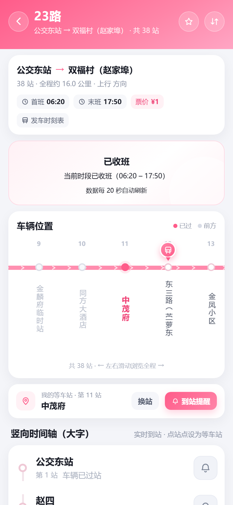
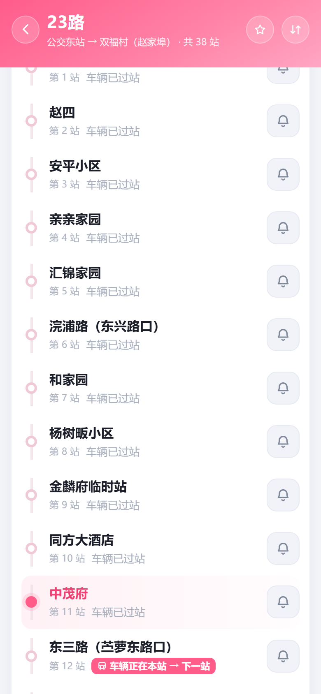
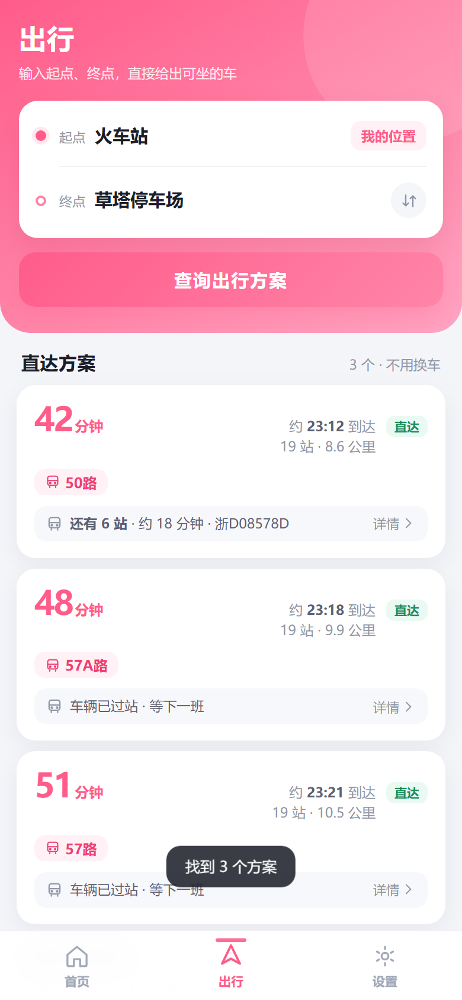
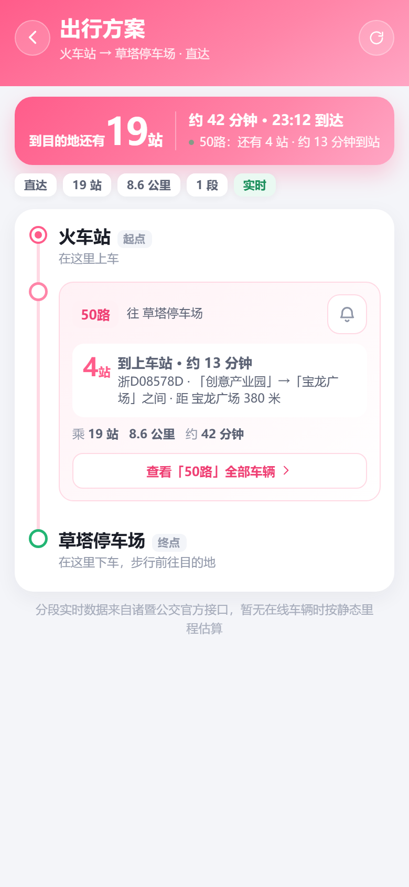
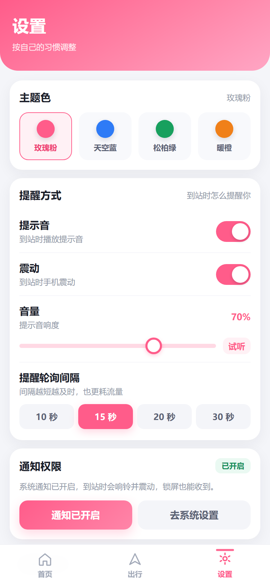
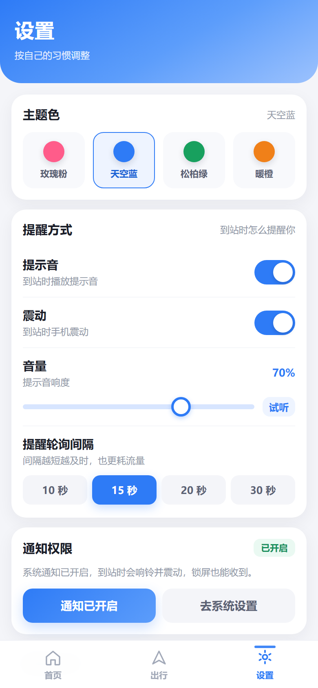
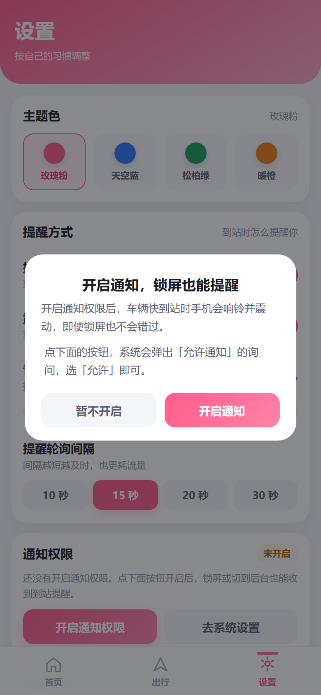
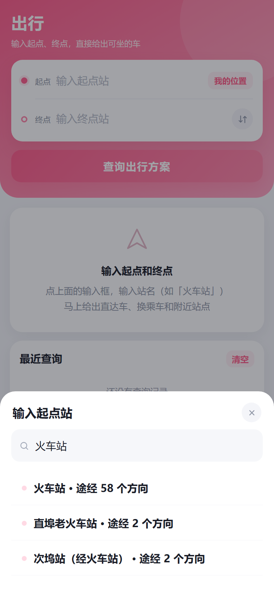
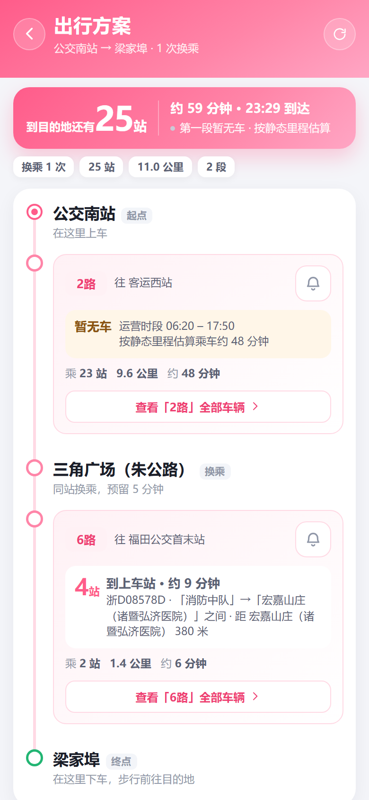
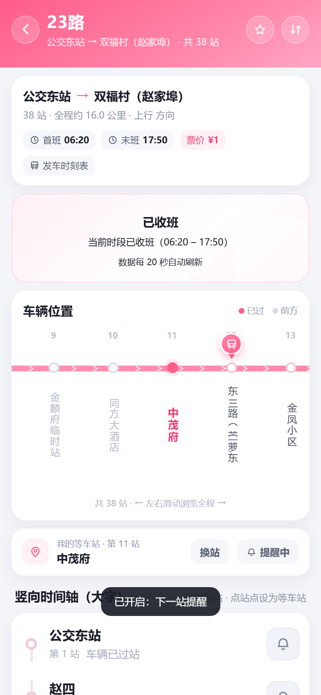

# 诸暨公交 · 长者易用版（v1.2.0）

> 基于 [`byazlle/zhuji-bus-live`](https://github.com/byazlle/zhuji-bus-live) **v2.0.0（APK 1.1.1）** 二次开发的精简版：去掉地图 SDK、公告与「我的」，只留 **首页 / 出行 / 设置** 三个标签。v1.2.0 加入**站名直查**（不再展开线路选站）、**直达 / 换乘 / 附近可达站点同屏**、**换乘流程详情（大字「到目的地还有 N 站」）**、**设置页（主题色 / 提示音 / 震动 / 音量 / 轮询间隔 / 通知权限 / 清缓存）**与**响铃 + 震动 + 系统通知**的到站提醒。

<p>


</p>

| 首页（精简） | 线路实时（横向时间轴） | 竖向时间轴 · 大字 |
|---|---|---|
|  |  |  |

| 出行结果（直达 / 换乘 / 附近） | 方案详情（还有 N 站） | 换乘流程 · 竖向 |
|---|---|---|
|  |  |  |

| 设置页 | 主题切换（天空蓝） | 通知权限引导 |
|---|---|---|
|  |  |  |

| 站名直查（无线路展开） | 站点选择弹层 · 大字 | 到站提醒（响铃 + 震动） |
|---|---|---|
|  |  |  |

---

## 在线体验与下载

| 类型 | 地址 |
|---|---|
| 网页版（手机浏览器打开） | **https://0124577.github.io/zhuji-bus-elder/** |
| 安卓安装包（APK 3.0 MB） | **[zhuji-bus-elder-v1.2.0.apk](https://github.com/0124577/zhuji-bus-elder/releases/download/v1.2.0/zhuji-bus-elder-v1.2.0.apk)** |
| 版本发布说明 | https://github.com/0124577/zhuji-bus-elder/releases/tag/v1.2.0 |
| 源码仓库 | https://github.com/0124577/zhuji-bus-elder |
| 上一版（v1.1.0） | https://github.com/0124577/zhuji-bus-easy/releases/tag/v1.1.0 |

APK 为自签名（`CN=Zhuji Bus Live`），安装时需在系统里允许「安装未知来源应用」；包名 `com.zhuji.bus.lite`，版本名 `1.2.0`（versionCode 3），最低 Android 5.1。

> v1.1.0 与 v1.2.0 **同一签名密钥**，可直接覆盖升级，收藏、历史与提醒都在本地，升级不丢。

---

## 一、项目介绍

诸暨公交官方实时接口（`zjcx.zhuji.gov.cn`）免登录可用，但原版页面以「线路列表 + 站点序列」为主，缺少**车辆在路上的位置**、**一句话说清坐哪几趟车**和**下车提醒**。本项目在 v2.0.0 的静态站点表与换乘算法上重做前端，目标用户是**看手机不太方便的长辈**：

- **只做三件事**：看车（实时公交）、去哪（直达 / 换乘）、设置（声音与提醒）
- **三个 Tab**：首页、出行、设置；没有公告、没有「我的」、没有地图
- **出行页一步到位**：输入起点与终点直接查，**不再展开线路选站**；结果同屏给出「直达方案 / 换乘方案 / 附近可达站点」
- **方案详情突出剩余站**：进入即用大字告诉你「**到目的地还有 N 站**」，下面按段给出实时车辆、到上车站还有几站、下车站提醒铃铛
- **能听见、能摸到**：到站提醒同时**响铃 + 震动 +（安卓）系统通知**，锁屏也能收到
- **字号与触控为长者放大**：站名 15.5–17px、行高 56px、按钮 ≥40px、弹层选项 15px/50px
- **没有地图**：跨站距离用 Haversine 本地计算，车辆位置用时间轴表达
- **静态兜底**：站点、线路、首末班、里程全部内置；实时接口连续失败时**自动降级**并给出醒目提示与重试

APK 包名 `com.zhuji.bus.lite`，版本 `1.2.0`，最低 Android 5.1（API 22），目标 API 34。

---

## 二、功能清单

### 首页（精简，无重复信息）
- 线路号搜索：395 条线路实时过滤（输入 `23` 即命中 `23路`），支持清空与空结果提示
- 我的收藏：收藏线路（胶囊）/ 收藏站点（列表），点击直达；**没有收藏时整块隐藏**，不留空白
- 到站提醒概览：显示「还有 2 站 · 约 4 分」或「已提醒 19:03」，可管理
- 全部线路：按号段排序，支持「加载更多」；行内星标一键收藏
- 已移除「附近站点」栏目（定位只服务出行页与线路页默认等车站）

### 线路实时页
- 顶部渐变头：线路名、起终点、站数、收藏、**换向**
- 信息卡：首末班、票价（接口返回时展示）、发车时刻表入口
- 数据卡：最近一辆车距**我的等车站**的 `剩余站数 / 预计分钟 / 剩余距离`、车牌、实时标记、车辆当前位置文案
- **横向线路时间轴**：站序编号 + 竖排站名 + 已过/前方站点区分 + 车辆图标按 GPS 位置落点；左右滑动浏览全程，自动居中到等车站
- **竖向时间轴（大字版）**：横向时间轴下方，15.5px 站名、56px 行高、连续轴线与圆点、`还有 N 站 · 约 X 分钟`、车辆徽标、40px 提醒铃铛
- 上下行切换、20 秒自动刷新（可改为 10/15/20/30 秒）、失败重试、收班时段提示
- 发车时刻表：官方全日班次，未发出的班次高亮

### 出行（本版重做）
- **起终点直接输入站名查询**，输入即过滤（中文模糊匹配，输入非数字也照常搜）；弹层空查询时列出**最近 5 个站点**，另有「我的位置」入口
- 起终点交换、查询即规划、最近查询（最多 20 条，单条删除 / 一键清空 / 点击重查）
- **结果同屏三段**：
  - **直达方案**：有直达就不必换乘，卡片直接给线路、站数、公里、分钟
  - **换乘方案**：无直达时给出 1 次换乘（必要时 2 次），最多各 3 个
  - **附近可达站点**：起点/终点 1 公里内最多 4 个站，标注「有直达」，一点即查
- 每张方案卡带实时摘要：`还有 N 站 · 约 X 分钟` 或 `暂无车辆 · 按静态估算`

### 方案详情（换乘流程 + 到站提醒）
- 顶部大字 hero：**「到目的地还有 N 站」**（35px）+ 右侧「约 X 分钟 · HH:MM 到达」+「线路：还有 N 站 · 约 X 分钟到站」
- 摘要胶囊：换乘次数 / 总站数 / 公里 / 段数 / `实时`
- **竖向换乘流程**：起点（粉点）→ 各乘车段 → 换乘站 → 终点（绿圈），一条 rail 走完
- 每段卡片：线路徽标 + 往方向 + **下车站提醒铃铛** + 实时块（大数字「还有 N 站到上车站 · 约 X 分钟」+ 车牌/位置）+ `乘 N 站 / 公里 / 约 X 分钟` + 「查看全部车辆」
- 提醒粒度：到站 / 下一站 / 提前 2 站，写入本地并与首页提醒卡片同步
- 轮询间隔跟随设置页（默认 15 秒），失败不影响其它段；接口异常时顶部出现「已自动降级」横幅

### 设置（本版新增）
- **主题色切换**：玫瑰粉 / 天空蓝 / 松柏绿 / 暖橙，CSS 变量 + `data-theme` 即时生效，同步 `theme-color`
- **提示音**：开/关；**音量**：0–100 滑杆（松手即试听，WebAudio 合成三声上行铃声，无需音频文件）
- **震动**：开/关（全局拦截 `navigator.vibrate`）
- **提醒轮询间隔**：10 / 15 / 20 / 30 秒，改后立即对线路页、详情页、提醒引擎生效
- **通知权限**：状态徽标（已开启 / 未开启 / 已关闭 / 不支持）+ 说明 + 一键申请 + 「去系统设置」；首次保存提醒时若无权限会弹窗引导
- **清除缓存**：只清收藏、历史、提醒与偏好（二次确认），不动静态数据
- **关于**：版本、包名、线路/站点数量、数据来源、许可

### 到站提醒（本地 + 系统通知）
- 三种粒度：到站（剩 0 站）、下一站（剩 1 站）、提前 2 站
- 触发：App 内弹窗 + **响铃** + **震动**；开通知权限后额外发**系统通知**（锁屏/后台可见，点击回到 App）
- 系统通道按「声音 / 震动」组合分建（Android 通道创建后不可改）
- 依赖实时接口：接口中断时状态显示「数据中断 / 暂停」，不会误报
- 最多同时 10 条，可单条删除或一键清空；完成 2 小时后自动清理

### 明确不做（需求外功能已剔除）
乘车码 · 云端推送订阅 · 云端到站订阅 · 意见反馈 · 登录注册 · 地图渲染 · 地图 SDK 路径规划 · 公告 Tab · 我的 Tab · 车辆实时地图打点

---

## 三、技术栈

| 层 | 方案 |
|---|---|
| 前端 | 原生 HTML / CSS / ES6，无框架、无打包器，11 个 JS 模块 + 2 个 CSS |
| 数据 | 内置 `www/data/snapshot.js`（395 线路 / 3061 站点 / 22186 条站序），实时数据走官方接口 |
| 主题 | CSS 变量（`--pink / --brand-rgb / --pink-t1..t4`）+ `:root[data-theme]` 四套配色 |
| 声音 | WebAudio `OscillatorNode` 合成（880 / 1046.5 / 1318.5 Hz），无音频文件 |
| 通知 | 自写 Capacitor 插件 `ZjNotifyPlugin`（check / request / notify / openSettings） |
| 本地存储 | `localStorage`（收藏 / 历史 / 提醒 / 偏好），WebView 内持久化 |
| 定位 | `navigator.geolocation` + Haversine 距离，不接地图 SDK |
| 安卓壳 | Capacitor 6.2.1 + Gradle 8.2.1 + AGP 8.2.1，minSdk 22 / targetSdk 34 |
| 测试 | puppeteer-core + 本地 Chrome，移动端 390×844 视口，**205 项断言** |

### 目录结构

```
zhuji-bus-elder/
├─ www/                     # 纯静态站点（可直接部署）
│  ├─ index.html            # 三 Tab 骨架 + 全屏页（线路 / 方案 / 站点）+ 设置页
│  ├─ css/
│  │  ├─ app.css            # 变量化主题与基础样式
│  │  └─ theme.css          # 四套配色 + 出行结果 / 换乘流程 / 设置页 / 弹层放大
│  ├─ js/
│  │  ├─ core.js            # 工具、数据索引、Prefs、Sound、Notify、时间轴、收藏、弹层
│  │  ├─ api.js             # 官方接口封装 + 实时数据加工（RT）+ 降级标记
│  │  ├─ reminder.js        # 到站提醒引擎（轮询、响铃、震动、系统通知）
│  │  ├─ picker.js          # 站名直查弹层（无线路展开）
│  │  ├─ line.js            # 线路实时页（时间轴、车辆、时刻表）
│  │  ├─ station.js         # 站点实时页
│  │  ├─ go.js              # 出行查询：直达 / 换乘 / 附近可达 + 历史
│  │  ├─ plan.js            # 方案详情：换乘流程 + 到目的地还有 N 站
│  │  ├─ settings.js        # 设置页（主题 / 声音 / 轮询 / 权限 / 清缓存 / 关于）
│  │  ├─ home.js            # 首页
│  │  └─ app.js             # Tab 路由、定位、启动
│  └─ data/snapshot.js      # 静态数据快照（由脚本生成）
├─ android/                 # Capacitor 安卓工程（含 ZjNotifyPlugin）
├─ scripts/
│  ├─ extract-data.py       # 从 v2.0.0 基线提取静态数据
│  ├─ make_icons.py         # 生成图标与启动图（纯标准库）
│  ├─ shot.mjs              # 界面截图脚本（生成 15 张截图）
│  └─ verify-live.mjs       # 线上部署校验（真实域名跑关键路径）
├─ tests/e2e/app-test.mjs   # 205 项 E2E 测试
├─ docs/自测报告.md
└─ README.md
```

---

## 四、快速开始（网页）

```bash
# 任意静态服务器即可，不能直接 file:// 打开（XHR 与模块加载）
python -m http.server 8899 --directory www
# 打开 http://127.0.0.1:8899
```

可选参数：

- `?mode=static`：强制静态模式（不请求实时接口，用于演示/离线）
- 默认 `api` 模式：实时接口失败时**自动**降级为静态站点数据
- 网页版没有原生插件，通知权限显示「不支持」，到站时仍会**弹窗 + 响铃 + 震动**；需锁屏通知请装 APK

---

## 五、数据说明

### 5.1 静态数据（兜底，随包内置）

`www/data/snapshot.js` 由 `scripts/extract-data.py` 从 v2.0.0 基线生成，结构：

```js
window.SNAPSHOT = {
  v: 2,
  generated: "2026-11-18",
  names: ["西施殿公交首末站", "西施殿", ...],       // 站点名池，下标即站名 ID
  lines: [{
    n: "23路",
    d: [{
      k: "up", id: "3306812312",                    // 方向线路 ID（实时接口用）
      f: "06:20", l: "17:50",                       // 首末班
      s: [[12, 480, 2971360, 12023620], ...]        // [站名ID, 到下一站米数, 纬度×1e5, 经度×1e5]
    }]
  }]
}
```

运行时索引（`core.js`）会展开为：线路名 → 方向 → 有序站点（含累计里程）、站点名 → 途经方向列表。换乘、耗时、附近站点全部基于这份数据在本地计算。

> 坐标已在基线中转换为 GCJ-02，与官方接口一致；距离使用 Haversine 球面公式（米）。

### 5.2 实时数据（官方接口）

基础地址 `https://zjcx.zhuji.gov.cn:9443`，POST JSON，固定请求头（见 `www/js/core.js` 的 `CFG.API_H`），返回 `code === "200"` 为成功。

| 用途 | 路径 | 关键参数 | 主要返回 |
|---|---|---|---|
| 线路详情 | `/gzcx-busServer/client/busLine/queryLine` | `lineId`（方向 ID） | `up.stationList`、`startFirst/startLast`、`totalPrice` |
| 实时车辆 | `/gzcx-busServer/client/bus/vehicle/dynamic/line/details` | `lineId` | `list[].vehicleOrder / distance / isArriveStation / plateNumber / gpsTime`、`busAverageSpeed` |
| 发车时刻表 | `/gzcx-busServer/client/busLine/getBusLinePlanSimpleTime` | `lineId` | `["06:20", ...]` |

**关键口径**（与官方接口一致，容易踩坑）：

- `vehicleOrder` = 车**已经驶离**的那一站（1 基），不是「下一站」
- `distance` = 到 `vehicleOrder + 1` 站的距离（米）
- 到某站的剩余站数 = `目标站序号 − vehicleOrder`；为 0 且 `isArriveStation !== 1` 视为刚离站
- 预计分钟 = `剩余米数 / busAverageSpeed + 剩余站数 × 0.35`（停靠折算）
- 「到目的地还有 N 站」= 各段剩余站数之和（换乘方案会累计未乘的段）

替换后端只需实现同样三个方法：`ZJ.Api.lineDetail / vehicles / plan`（`www/js/api.js`）。

---

## 六、网页部署

### GitHub Pages

本项目已部署：**https://0124577.github.io/zhuji-bus-elder/**（分支 `gh-pages`，根目录即 `www/` 内容）。

仓库结构里网页源码位于 `www/`，Pages 需要站点在分支根目录，因此用 subtree 推送：

```bash
# 首次：把 www/ 推成 gh-pages 分支（分支根目录 = www 内容）
git subtree push --prefix www origin gh-pages

# 之后每次改动 www/ 再执行同一条命令即可增量更新
```

也可在仓库 **Settings → Pages** 手动选择分支 `gh-pages` / 根目录。

### 任意静态托管

把 `www/` 整个目录上传即可（Nginx、OSS、Vercel、Netlify 均可），无需 Node 服务端。

---

## 七、安卓打包教程

### 7.1 环境

| 依赖 | 版本 |
|---|---|
| JDK | 17（`JAVA_HOME`） |
| Android SDK | Platform 34 + Build-Tools 34.0.0（`ANDROID_HOME` 或 `android/local.properties`） |
| Gradle | 8.2.1（AGP 8.2.1，可用 wrapper 或本地安装） |
| Node.js | 18+（仅用于 Capacitor CLI） |

### 7.2 步骤

```bash
npm install                     # @capacitor/core、android、cli
npx cap sync android            # 把 www/ 同步到 android/app/src/main/assets/public
```

`android/local.properties`：

```properties
sdk.dir=/path/to/Android/Sdk
```

签名（`android/app/build.gradle` 已配置 `release`）：

```groovy
signingConfigs {
    release {
        storeFile file("../release.keystore")
        storePassword "******"
        keyAlias "zjbus"
        keyPassword "******"
    }
}
```

构建：

```bash
cd android
./gradlew assembleRelease
# 产物：android/app/build/outputs/apk/release/app-release.apk
```

首次打包请替换为自己的 keystore：

```bash
keytool -genkeypair -v -keystore release.keystore -alias zjbus \
  -keyalg RSA -keysize 2048 -validity 10950
```

### 7.3 安卓侧改动

- `AndroidManifest.xml`：`INTERNET`、`ACCESS_FINE_LOCATION`、`ACCESS_COARSE_LOCATION`、`VIBRATE`、**`POST_NOTIFICATIONS`**
- `MainActivity.java`：`onCreate` 第一行 `registerPlugin(ZjNotifyPlugin.class)`（必须在 `super.onCreate` 之前），随后申请定位权限、开启 WebView 的 `Geolocation / DOM Storage`
- **`ZjNotifyPlugin.java`（自写插件）**：
  - `check()` → `{granted, enabled, canAsk}`（权限 + 通道开关双重判断）
  - `request()` → 走 Android 13+ 运行时权限 `POST_NOTIFICATIONS`
  - `notify({title, body, sound, vibrate})` → 建通道发 `NotificationCompat` 通知（`BigTextStyle`），点击打开 `MainActivity`；无权限时返回 `{shown:false, reason:'no-permission'}`
  - `openSettings()` → `ACTION_APP_NOTIFICATION_SETTINGS`，退化 `ACTION_APPLICATION_DETAILS_SETTINGS`
- 主题：状态栏 `#FF5C8A`、浅色导航栏；启动图为粉色渐变 + 巴士标志
- 包名 `com.zhuji.bus.lite`，`versionCode 3` / `versionName 1.2.0`

---

## 八、测试

```bash
python -m http.server 8899 --directory www     # 终端 1
node tests/e2e/app-test.mjs                    # 终端 2（需本地 Chrome）
```

- 结果：**205 项断言全部通过**，控制台 0 个 JS 错误（18 个分组）
- 覆盖：静态数据加载、首页栏目精简、Tab 三栏切换、定位能力、线路搜索、线路实时页、竖屏横向站点列表、竖向大字时间轴、上下行切换、收藏线路/站点、时刻表、本地到站提醒（响铃 + 震动）、站点实时页、**出行站名直查**、**直达/换乘/附近可达三类结果**、**换乘流程详情与「到目的地还有 N 站」**、**设置页（主题 / 声音 / 轮询 / 权限 / 清缓存 / 关于）**、**到站提醒（响铃 + 震动 + 系统通知）**、安卓返回键、定位失败、网络异常自动降级、无直达、无结果空态、移动端横向溢出、禁用功能核查
- 详见 [docs/自测报告.md](docs/自测报告.md)

线上部署校验（直接跑真实域名，确认 Pages 资源与功能正常）：

```bash
node scripts/verify-live.mjs https://0124577.github.io/zhuji-bus-elder/
# 18 项：标题、静态数据 395 线 / 779 向 / 3061 站、三个 Tab、站名直查、
#       设置页 4 主题 / 2 开关 / 4 档轮询、部署版本含「到目的地还有」等
```

---

## 九、已知限制

1. 实时接口由诸暨公交官方提供，**收班后（约 18:00 后）多数线路无在线车辆**，页面显示「已收班 / 此刻暂无在线车辆」并给出静态时刻表估算，不会编造数据。
2. 到站提醒依赖接口轮询：网页版前台可用（弹窗 + 响铃 + 震动）；**锁屏 / 后台的系统通知仅在 APK 且授予通知权限时可用**。
3. 无地图 SDK，换乘耗时与站间距离均为**直线距离 / 静态里程**估算，不含步行路径与实时路况。
4. 静态快照为 2026-11 的站点表，官方调整线路后需重新执行 `python scripts/extract-data.py`（来源为 v2.0.0 基线 `index.html`）。
5. 发车时刻表部分线路官方返回空数组，此时仅展示首末班。
6. 主题色只改变品牌色与浅色底，状态栏颜色随主题同步；系统级深色模式未做适配（保证对比度与大字可读性优先）。

---

## 十、致谢与免责

- 数据与站点表来源：[`byazlle/zhuji-bus-live`](https://github.com/byazlle/zhuji-bus-live)（v2.0.0 基线）
- 接口信息参考：[`fgh1995/zhujibus`](https://github.com/fgh1995/zhujibus)
- 本项目仅用于个人出行辅助，所有到站时间与换乘方案**仅供参考**，请以实际运营为准；请勿用于商业用途或高频抓取。

MIT License
